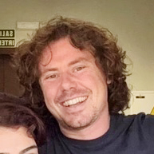

## About Me

I am a theoretical physicist, currently working as a postdoc in the group of [Adolfo Grushin](https://www.ikerbasque.net/en/adolfo-g-grushin) at the Donostia International Physics Center in San Sebastian / Donostia.

## Research Interests

Most of my work centers on understanding how topological and symmetry-protected phases of matter can be understood without relying on momentum space. I have worked a lot on non-interacting topological systems such as Chern insulators, spin Hall, with crystal-symmetric materials. More recently I am focussing mostly on interacting phases such as magnetic matter, fractional Hall phases and quantum spin liquids. 

### Some links:

[Google scholar](https://scholar.google.com/citations?user=RcwugQMAAAAJ&hl=en) / [Github](https://github.com/dpreuo) / [arXiv](https://arxiv.org/search/?searchtype=author&query=d%27Ornellas%2C+P) / [Orcid](https://orcid.org/0000-0002-2349-0044)

## Recent Works









<a href="{{ pub.link }}">{{ pub.title }}</a>

{{ pub.authors }} <em>{{ pub.journal }}</em> ({{ pub.year }})

{{ pub.blurb | markdownify }}



This website is based on the [researcher](https://github.com/ankitsultana/researcher) template by Ankit Sultana.